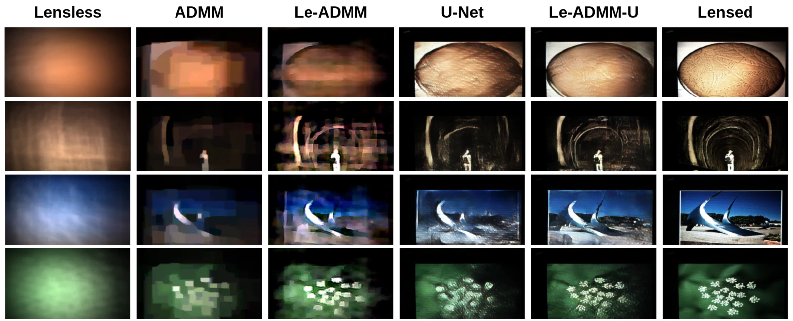

# Lensless Camera Reconstruction

Recover RGB images from diffuser-camera measurements with a calibrated optical model and learned reconstruction. The PyTorch implementation compares total-variation ADMM, a direct U-Net, and learned ADMM with and without a U-Net denoiser.

[Presentation (PDF)](docs/lensless-camera-reconstruction.pdf) · [Experiment logs](docs/results.md) · [References](docs/references.md)

## Results



Le-ADMM-U outperformed the standalone U-Net by **1.8 dB PSNR** in the [presentation comparison](docs/lensless-camera-reconstruction.pdf#page=9).

| Method | PSNR (dB) ↑ | SSIM ↑ | LPIPS ↓ |
| --- | ---: | ---: | ---: |
| ADMM with total variation | 15.2 | 0.51 | 0.50 |
| Le-ADMM | 14.8 | 0.48 | 0.47 |
| U-Net | 18.9 | 0.59 | 0.26 |
| Le-ADMM-U | **20.7** | **0.66** | **0.23** |

The data are paired lensless captures and lensed references from the [DiffuserCam Lensless MIRFlickr dataset](https://huggingface.co/datasets/bezzam/DiffuserCam-Lensless-Mirflickr-Dataset-NORM). The table reports the presentation results. The [checked-in logs](docs/results.md) document smaller development runs on different image sets.

## Method

- **ADMM** fits the sensor measurement using convolution with the camera’s point-spread function (PSF) followed by sensor cropping. Total variation regularizes the reconstruction, and a nonnegativity constraint keeps pixel values physical.
- **Le-ADMM** unrolls five ADMM iterations and learns the regularization and penalty parameters per iteration. **Le-ADMM-U** adds a U-Net after the last iteration to recover detail.
- **U-Net** maps the measurement directly to an image. A separate [conditional flow-matching model](configs/flow.yaml) is also available.

The [evaluation script](scripts/evaluate_model.py) scores real captures and measurements simulated with the original and a second PSF. For Le-ADMM it also tests swapping in the second PSF while keeping the learned weights fixed.

## Run

Use Python 3.11+ and [uv](https://docs.astral.sh/uv/). Training runs can also be launched from the [Colab notebooks](notebooks/).

```bash
uv sync --locked
uv run pytest
uv run python scripts/run_admm.py --config configs/admm_quick.yaml
uv run python scripts/train_unet.py --config configs/unet_small.yaml
uv run python scripts/train_le_admm.py --config configs/le_admm.yaml
uv run python scripts/evaluate_model.py --config configs/evaluate.yaml \
  --checkpoint /path/to/best.pt --set data.split=test
```
